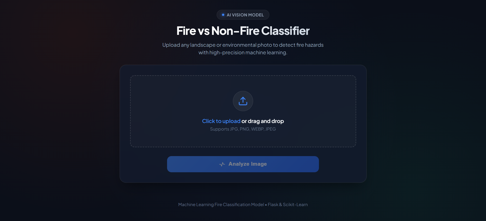

# 🔥 Fire vs Non-Fire Image Classifier (ML & Flask Web App)

[](https://www.python.org/)
[](https://flask.palletsprojects.com/)
[](https://scikit-learn.org/)
[](https://www.kaggle.com/datasets/phylake1337/fire-dataset)

An end-to-end Machine Learning web application that detects fire hazards in environmental and landscape imagery in real-time. Built with a trained **Scikit-Learn** classification model, a **Flask** backend, and a modern glassmorphic web interface.

---

## 📸 App Preview

<p align="center">
  
</p>

---

## 🌟 Key Features

- **Real-Time Image Classification:** Instant inference classifying images as **🔥 FIRE DETECTED** or **🌿 NON-FIRE (SAFE)**.
- **Confidence Scoring:** Outputs prediction probability and visual confidence percentage.
- **Interactive Web Interface:** Modern glassmorphism UI with drag-and-drop file upload, live image preview, and laser-scan loading animation.
- **Lightweight & Fast:** Optimized image preprocessing pipeline with sub-second response times.
- **Responsive Design:** Fully responsive layout for desktop, tablet, and mobile devices.

---

## 📊 Dataset & Model Details

* **Dataset Source:** [Kaggle Fire Dataset](https://www.kaggle.com/datasets/phylake1337/fire-dataset)
* **Image Preprocessing:** 
  * Converted to RGB
  * Resized to standard `64x64` resolution
  * Flattened to a 1D vector (`12,288` features)
  * Min-Max normalized (`[0, 1]` range)
* **Model Architecture:** Logistic Regression classifier (`max_iter=1000`)
* **Test Accuracy:** **~90%**
* **Classification Metrics:**
  * **Fire Detection Precision:** 95% | **Recall:** 92% | **F1-Score:** 0.93
  * **Non-Fire Precision:** 77% | **Recall:** 84% | **F1-Score:** 0.80

---

## 📁 Project Structure

```text
fire_classification_ml/
├── static/
│   └── style.css            # Glassmorphism styling and animations
├── templates/
│   └── index.html           # Modern frontend template with Jinja2
├── train.ipynb              # Model training, evaluation & serialization
├── app.py                   # Flask backend & inference server
├── fire_model.pkl           # Pretrained Scikit-Learn classification model
├── display.PNG              # UI preview screenshot
├── requirements.txt         # Project dependencies
├── .gitignore               # Ignored files (datasets, venv, cache)
└── README.md                # Project documentation
```

---

## 🚀 Getting Started

### 1. Clone the Repository

```bash
git clone https://github.com/sarukhmazari/fire_classification_ml.git
cd fire_classification_ml
```

### 2. Create and Activate a Virtual Environment

```bash
# Windows
python -m venv venv
venv\Scripts\activate

# macOS / Linux
python3 -m venv venv
source venv/bin/activate
```

### 3. Install Dependencies

```bash
pip install -r requirements.txt
```

### 4. Run the Application

```bash
python app.py
```

Open your browser and navigate to:
```text
http://127.0.0.1:5000
```

---

## 🧪 Training the Model from Scratch

If you wish to retrain the model:

1. Download the dataset from [Kaggle Fire Dataset](https://www.kaggle.com/datasets/phylake1337/fire-dataset).
2. Extract the dataset folders (`fire_images/` and `non_fire_images/`) into the project root directory.
3. Open and run all cells in [train.ipynb](train.ipynb).
4. The newly trained model will be saved as `fire_model.pkl`.

---

## 🛠️ Technologies Used

* **Language:** Python 3.9+
* **Backend:** Flask
* **Machine Learning:** Scikit-Learn, NumPy, Pillow, Joblib
* **Frontend:** HTML5, CSS3, JavaScript (Vanilla Glassmorphism UI)

---

## 👤 Author

* **Sarukh Mazari** - [@sarukhmazari](https://github.com/sarukhmazari)
